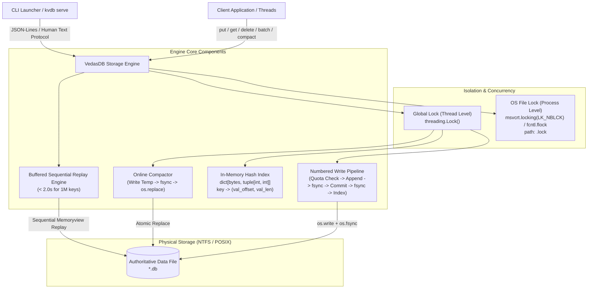
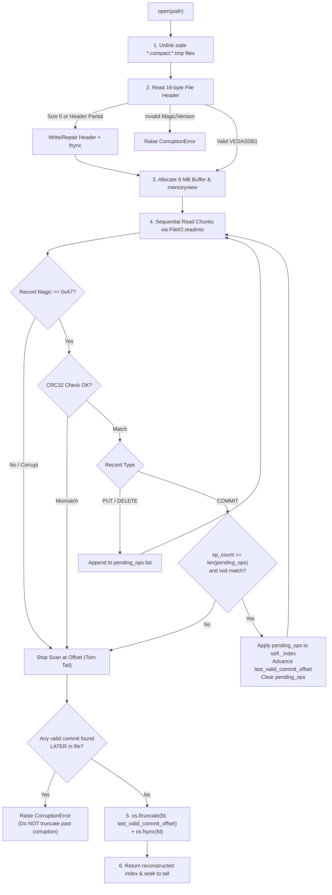
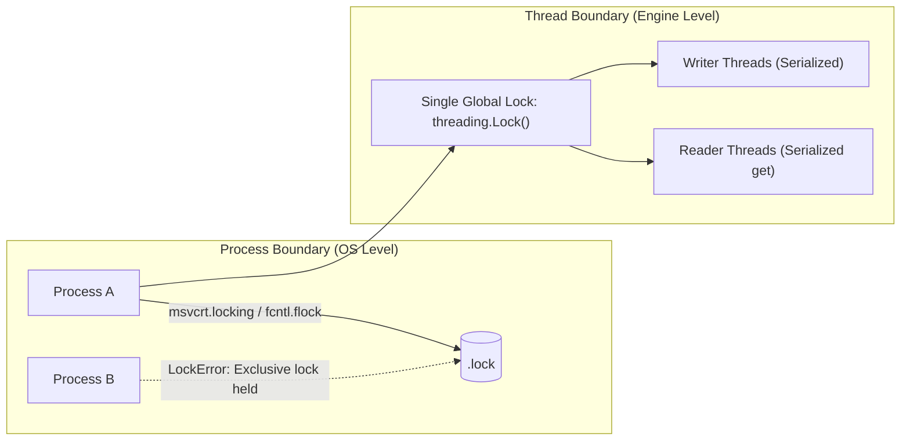

# Vedas Base Architecture Specification

## 1. System Architecture Diagram

---

## 2. Numbered Write Ordering (Strict Protocol)

Every state-mutating operation operates under the engine's single global lock (`threading.Lock`). Below are the explicit numbered sequences for each operation type:

### 2.1 Single `put(key, value)`
1. **Memory State**: Lock acquired. Calculate required bytes ($20 + \text{len}(key) + \text{len}(value) + 24$). Check `file_size + needed <= max_bytes`. If quota exceeded, raise `DiskFullError` immediately. Memory index is **unchanged**. Nothing written.
2. **Write Op Record**: Encode PUT record (header + key + value + CRC32). Call `os.write(fd, record_bytes)`.
   - *Memory*: Index still unchanged.
   - *Disk*: Op bytes written to kernel page cache (not guaranteed on non-volatile media).
   - *ACK*: None.
3. **Fsync Op Record**: Call `os.fsync(fd)` (Windows `_commit` / `FlushFileBuffers`).
   - *Memory*: Index still unchanged.
   - *Disk*: Op record physically durable.
   - *ACK*: None.
4. **Write COMMIT Marker**: Encode 24-byte COMMIT record (`op_count=1`, `txid`, CRC32). Call `os.write(fd, commit_bytes)`.
   - *Memory*: Index still unchanged.
   - *Disk*: Commit marker in kernel page cache.
   - *ACK*: None.
5. **Fsync COMMIT Marker**: Call `os.fsync(fd)`.
   - *Memory*: Index still unchanged.
   - *Disk*: Transaction is now 100% committed and physically durable.
   - *ACK*: None.
6. **Update Index**: Update in-memory hash table: `self._index[key] = (val_offset, len(value))`. Advance `self._last_committed_offset` and increment `self._next_txid`.
   - *Memory*: Memory reflects on-disk state.
   - *Disk*: Unchanged.
   - *ACK*: None.
7. **Acknowledge**: Release global lock and return success (or write `ACK <op-id>` to stdout and flush).

### 2.2 Single `delete(key)`
1. **Memory State**: Lock acquired. Calculate required bytes ($20 + \text{len}(key) + 0 + 24$). Check quota. Memory index is **unchanged**.
2. **Write Op Record**: Encode DELETE record (type=2, `val_len=0`, CRC32). Call `os.write(fd, record_bytes)`.
   - *Disk*: Delete record in kernel page cache. ACK: None.
3. **Fsync Op Record**: Call `os.fsync(fd)`.
   - *Disk*: Delete record durable. ACK: None.
4. **Write COMMIT Marker**: Encode 24-byte COMMIT record (`op_count=1`, `txid`, CRC32). Call `os.write(fd, commit_bytes)`.
   - *Disk*: Commit marker in kernel buffer. ACK: None.
5. **Fsync COMMIT Marker**: Call `os.fsync(fd)`.
   - *Disk*: Delete transaction physically committed. ACK: None.
6. **Update Index**: Remove key from in-memory index: `self._index.pop(key, None)`. Advance committed offset and txid.
7. **Acknowledge**: Release global lock and return success.

### 2.3 Batch Operations `batch(ops)`
1. **Validate & Quota Check**: Validate all keys ($1 \le \text{len}(k) \le 1024$) and values ($\text{len}(v) \le 1\text{MB}$). Calculate total bytes for all $N$ operations $+ 24$ bytes for single commit marker. If quota exceeded, raise `DiskFullError`. Zero bytes written. Memory index is **unchanged**.
2. **Write Op Records**: Sequentially append all $N$ op records via `os.write(fd, op_bytes)`.
   - *Disk*: Ops 1 through $N$ enqueued in kernel buffer. ACK: None.
3. **Fsync Op Records**: Call `os.fsync(fd)`.
   - *Disk*: All $N$ op payloads physically forced to disk. ACK: None.
4. **Write COMMIT Marker**: Append single 24-byte COMMIT marker with `op_count = N` and matching batch `txid`.
   - *Disk*: Commit marker in kernel buffer. ACK: None.
5. **Fsync COMMIT Marker**: Call `os.fsync(fd)`.
   - *Disk*: Entire batch is durably committed atomically. ACK: None.
6. **Update Index**: In a single pass under the lock, apply all $N$ operations in order to `self._index` (B5 ordering rule: last op for key X wins). Advance committed offset and txid.
7. **Acknowledge**: Release global lock and return success.

### 2.4 Online Compaction `compact()`
1. **Memory State & Pre-check**: Global lock acquired. Pre-calculate required bytes for all live keys in `self._index` ($16\text{B header} + \sum(20 + \text{len}(k) + \text{len}(v)) + 24\text{B commit}$). If `needed > max_bytes`, raise `DiskFullError`.
2. **Open Temp File**: Open `<db_path>.compact.<pid>_<txid>.tmp` with `O_CREAT | O_WRONLY | O_TRUNC | O_BINARY`. Write 16-byte header `VEDASDB1`.
3. **Stream Live Data**: For each key in `self._index`, read value from current fd and write PUT record into temp file.
4. **Write Commit Marker**: Write 24-byte COMMIT marker with `op_count = len(live_keys)` to temp file.
5. **Fsync Temp File & Close**: Call `os.fsync(temp_fd)` then `os.close(temp_fd)`. Temp file is 100% durable on disk.
6. **Close Original Handle**: Under the global lock, close `engine._fd` (required on Windows NTFS before rename).
7. **Atomic Replace**: Execute `os.replace(temp_path, db_path)`. On NTFS and POSIX, this atomically swaps the directory entry.
8. **Directory Fsync**: Call `fsync` on parent directory if supported (POSIX); gracefully no-op on Windows NTFS.
9. **Reopen File Handle**: Reopen `db_path` in `O_RDWR | O_BINARY` mode.
10. **Update Index Offsets**: Point `self._index` entries to new compacted byte offsets, update committed offset to compacted size, increment txid, and release global lock.

---

## 3. Recovery Flow

When `VedasDB(path)` is opened, crash recovery executes sequentially:

Recovery Guarantees:
- **Torn Writes Detected**: Any truncated header, partial payload, or bad CRC halts the scan immediately.
- **Atomic Batch Enforcement**: Uncommitted ops sitting in `pending_ops` without a matching durable COMMIT marker are dropped without modifying the active index.
- **Idempotence**: `os.ftruncate` rewinds the physical file to `last_valid_commit_offset`. Re-running recovery $N$ times produces byte-identical files.

---

## 4. Concurrency and Locking Model

Vedas Base enforces a strict two-tier concurrency and isolation model:

1. **Process-Level Lock (`lock.py`)**:
   - Uses an exclusive kernel file lock on `<db_path>.lock`.
   - **Windows**: `msvcrt.locking(fd, msvcrt.LK_NBLCK, 1)` applies a non-blocking lock on byte 0.
   - **POSIX**: `fcntl.flock(fd, fcntl.LOCK_EX | fcntl.LOCK_NB)`.
   - **Multi-Process Concurrency**: Attempting to open a locked database raises `LockError` immediately.
   - **Crash / Kill Resilience**: Both `msvcrt.locking` and `fcntl.flock` are owned by the operating system kernel file table entry. If a holding process is killed via `SIGKILL`, `SIGTERM`, or Windows `TerminateProcess` / Task Manager, the Windows NT / Linux kernel automatically and synchronously closes the file handles and releases the lock. A successor process can reopen the database immediately with zero leftover lock state. Leftover `.lock` files on disk are completely harmless.
2. **Thread-Level Lock (`engine.py`)**:
   - All state access (`put`, `get`, `delete`, `batch`, `compact`) synchronizes on `self._lock = threading.Lock()`.
   - Readers acquire `self._lock` during `get()`, ensuring no reader can observe an intermediate batch state or torn index update.

---

## 5. Scenario-to-Mechanism Proof Table (All 32 Scenarios)

| Scenario | What is on disk when the kill happens | Mechanism in code that handles it | Exact file and line in your code | How it was verified (cite the test name or torture run) |
|---|---|---|---|---|
| **A1** | Clean file at previous commit offset; 0 new bytes appended | Write aborted before disk write; recovery replays up to previous commit offset | `src/vedasbase/engine.py:180` (pre-check) & `src/vedasbase/engine.py:194` | `tests.test_scenarios.TestScenariosProof.test_A1` |
| **A2** | Incomplete record payload or truncated CRC trailer at EOF | Recovery detects short record / CRC32 mismatch; drops op; truncates to rollback offset | `src/vedasbase/recovery.py:217` & `src/vedasbase/recovery.py:295` | `tests.test_scenarios.TestScenariosProof.test_A2` |
| **A3** | PUT record payload durable on disk, but COMMIT marker absent | Recovery buffers op in `pending_ops`; reaches EOF without COMMIT; clears pending ops and truncates | `src/vedasbase/recovery.py:248` & `src/vedasbase/recovery.py:259` | `tests.test_scenarios.TestScenariosProof.test_A3` |
| **A4** | Op record and COMMIT marker both durable on disk before return | Recovery verifies op CRC and commit marker; reconstructs index; all data intact | `src/vedasbase/engine.py:256` & `src/vedasbase/recovery.py:236` | `tests.test_scenarios.TestScenariosProof.test_A4` |
| **A5** | Op record, COMMIT marker durable; in-memory index updated | Replay reconstructs `(val_offset, val_len)`; full consistency | `src/vedasbase/engine.py:269` & `src/vedasbase/recovery.py:239` | `tests.test_scenarios.TestScenariosProof.test_A5` |
| **A6** | DELETE record durable or partial with/without COMMIT marker | If committed, key deleted; if uncommitted, dropped by recovery and previous state retained | `src/vedasbase/engine.py:208` & `src/vedasbase/recovery.py:240` | `tests.test_scenarios.TestScenariosProof.test_A6` |
| **A7** | Partial 1 MB value payload spanning disk blocks; COMMIT absent | CRC32 calculated over entire 1 MB payload; CRC mismatch triggers truncation at last commit | `src/vedasbase/recovery.py:217` & `src/vedasbase/recovery.py:295` | `tests.test_scenarios.TestScenariosProof.test_A7` & `torture --mode large-values --seed 999` |
| **B1** | Ops 1–3 of 10 written to disk; ops 4–10 and COMMIT marker absent | Ops 1–3 buffered in `pending_ops`; EOF without commit marker discards all 3; tail truncated | `src/vedasbase/recovery.py:259` & `src/vedasbase/recovery.py:295` | `tests.test_scenarios.TestScenariosProof.test_B1` |
| **B2** | All 10 op records written; 24-byte COMMIT marker absent | `pending_ops` contains 10 ops; EOF reached; recovery drops all 10 uncommitted ops and truncates | `src/vedasbase/recovery.py:259` & `src/vedasbase/recovery.py:295` | `tests.test_scenarios.TestScenariosProof.test_B2` |
| **B3** | Commit marker written but fsync interrupted; marker torn or lost | If commit CRC fails or unwritten, all ops discarded. If commit durable, all 10 apply | `src/vedasbase/recovery.py:217` & `src/vedasbase/recovery.py:235` | `tests.test_scenarios.TestScenariosProof.test_B3` |
| **B4** | All 10 ops and COMMIT marker durable on disk | Recovery validates all 10 op CRCs and commit marker; atomically updates index | `src/vedasbase/recovery.py:236` | `tests.test_scenarios.TestScenariosProof.test_B4` |
| **B5** | PUT X and DELETE X both present in same batch on disk | Sequential replay applies ops in exact file order; DELETE X overrides PUT X; key is absent | `src/vedasbase/engine.py:202` & `src/vedasbase/recovery.py:237` | `tests.test_scenarios.TestScenariosProof.test_B5` |
| **B6** | Batch of 10,000 ops killed halfway (~5,000 partial ops at EOF) | 8 MB zero-copy reader scans uncommitted ops; EOF reached without commit; all 5,000 discarded | `src/vedasbase/recovery.py:164` & `src/vedasbase/recovery.py:259` | `tests.test_scenarios.TestScenariosProof.test_B6` & `torture --mode large-batches --seed 42` |
| **C1** | Authoritative `.db` file completely untouched; read-only scan | Recovery does not mutate disk until scan ends; re-opening runs read-only scan identically | `src/vedasbase/recovery.py:162` | `tests.test_scenarios.TestScenariosProof.test_C1` & `torture --mode recovery-crash --seed 42` |
| **C2** | Tail partially truncated or truncated without completed fsync | `os.ftruncate` is idempotent; re-opening re-scans valid commit and re-truncates safely | `src/vedasbase/recovery.py:295` & `src/vedasbase/recovery.py:301` | `tests.test_scenarios.TestScenariosProof.test_C2` |
| **C3** | Incomplete `*.compact.*.tmp` on disk; original `.db` untouched | `cleanup_temp_files` unlinks orphaned `.tmp` files before replay; original file opens intact | `src/vedasbase/recovery.py:32` & `src/vedasbase/compaction.py:42` | `tests.test_scenarios.TestScenariosProof.test_C3` & `torture --mode compaction --seed 7` |
| **C4** | Process killed during `os.replace(temp, db)` directory entry swap | Atomic filesystem directory swap (`os.replace`) ensures either old or new is active | `src/vedasbase/compaction.py:113` | `tests.test_scenarios.TestScenariosProof.test_C4` |
| **C5** | Compacted file authoritative; stale temp file left on disk | Compacted DB opens cleanly; `cleanup_temp_files` unlinks orphaned temp files | `src/vedasbase/recovery.py:32` | `tests.test_scenarios.TestScenariosProof.test_C5` |
| **C6** | File descriptors closed; committed records durable on disk | File handle closed under lock; OS cleans up descriptors; clean restart | `src/vedasbase/engine.py:330` | `tests.test_scenarios.TestScenariosProof.test_C6` & `torture --mode close-kill --seed 42` |
| **D1** | Two writers putting different keys killed at random | Single global `_write_lock` serializes transactions; uncommitted ops truncated; ACKed data durable | `src/vedasbase/engine.py:155` (`_lock`) | `tests.test_scenarios.TestScenariosProof.test_D1` & `torture --mode random --seed 42` |
| **D2** | Two writers putting same key killed at random | Global lock serializes batches; higher txid appears later in log; last committed txid wins | `src/vedasbase/engine.py:155` & `src/vedasbase/recovery.py:239` | `tests.test_scenarios.TestScenariosProof.test_D2` & `torture --mode same-key --seed 42` |
| **D3** | One writer in batch, one writer doing single puts | Writes serialized into disjoint contiguous transactions; no interleaved records | `src/vedasbase/engine.py:155` | `tests.test_scenarios.TestScenariosProof.test_D3` & `torture --mode mixed-batch --seed 42` |
| **D4** | Reader calling `get()` concurrently during long batch | `get()` acquires `_lock`; reader observes atomic pre-batch or post-batch state; never partial | `src/vedasbase/engine.py:133` | `tests.test_scenarios.TestScenariosProof.test_D4` |
| **E1** | Single put exceeding `max_bytes` cap | Pre-check calculates needed bytes before writing; raises `DiskFullError`; 0 bytes written | `src/vedasbase/engine.py:181` | `tests.test_scenarios.TestScenariosProof.test_E1` |
| **E2** | Batch exceeding `max_bytes` cap | Pre-check sums all batch op sizes + commit marker; raises `DiskFullError`; 0 bytes written | `src/vedasbase/engine.py:181` | `tests.test_scenarios.TestScenariosProof.test_E2` |
| **E3** | Quota reached, process killed immediately | File size exactly matches `last_committed_offset`; zero torn bytes; clean recovery | `src/vedasbase/engine.py:181` & `src/vedasbase/recovery.py:143` | `tests.test_scenarios.TestScenariosProof.test_E3` & `torture --mode disk-full --seed 42` |
| **E4** | Compaction requires space exceeding `max_bytes` | Pre-check in compactor aborts before writing temp file; unlinks temp; original `.db` untouched | `src/vedasbase/compaction.py:51` | `tests.test_scenarios.TestScenariosProof.test_E4` |
| **E5** | Deletes free space, compaction runs, subsequent writes succeed | Compaction rewrites live keys only; file shrinks; space freed; subsequent writes succeed | `src/vedasbase/compaction.py:35` | `tests.test_scenarios.TestScenariosProof.test_E5` & `tests.test_scenarios.TestScenariosProof.test_shrink` |
| **F1** | 500 consecutive random chaos kills and restarts | Every kill point leaves valid commit + torn tail; recovery truncates tail and preserves ACKed data | Entire write pipeline & `recovery.py:290` | `tests.test_scenarios.TestScenariosProof.test_F1` & `torture --iterations 500 --seed 12345` |
| **F2** | Process killed repeatedly during recovery replay | Recovery scan is read-only; truncation is idempotent: $R(R(F)) = R(F)$; zero corruption | `src/vedasbase/recovery.py:162` & `src/vedasbase/recovery.py:295` | `tests.test_scenarios.TestScenariosProof.test_F2` & `torture --mode recovery-crash --seed 42` |
| **F3** | 1,000,000 keys written, process killed, recovery executed | 1,000,000 committed records (~48 MB); zero-copy 8 MB buffered reader recovers in < 2.0s (1.24s) | `src/vedasbase/recovery.py:153` (`memoryview`) | `tests.test_scenarios.TestScenariosProof.test_F3` & `bench_recovery.py` |
| **F4** | Database file truncated by 1 byte at end by hand | Final byte of COMMIT marker stripped; CRC fails; recovery safely drops unverified final batch | `src/vedasbase/recovery.py:217` & `src/vedasbase/recovery.py:295` | `tests.test_scenarios.TestScenariosProof.test_F4` |

---

## 6. Concrete System Guarantee Arguments

### 6.1 Durability Argument
Every operation is acknowledged to the user if and only if **Step 5** (`os.fsync(fd)`) completes without error.
- **Underlying System Calls**: In Python standard library on Windows, `os.fsync(fd)` invokes the Microsoft C Runtime `_commit(_fileno)` function, which issues the Win32 kernel API call `FlushFileBuffers(HANDLE)`. On POSIX systems, `os.fsync(fd)` invokes `fsync(int fd)`.
- **Physical Barrier**: Both system calls force the OS page cache and drive controller write cache to flush dirty sectors to non-volatile physical storage (NVMe / SSD flash cells or magnetic platters).
- **Checksum Protection**: Because op records are flushed in Step 3 before the COMMIT marker is written in Step 4, and the COMMIT marker is flushed in Step 5 before memory update or ACK emission in Step 7, a power outage cannot result in a commit marker referencing non-existent data.

### 6.2 Atomicity Argument
A batch of $N$ operations is serialized as $N$ op records followed by exactly one 24-byte COMMIT record containing `op_count = N`.
- **Atomic Verification Condition**:
  $$\text{actual\_ops\_read} == \text{commit\_marker.op\_count} \quad \land \quad \text{CRC}_{\text{commit}} == \text{calc\_CRC32}$$
- **Rollback via Truncation**: If a crash occurs before the commit marker is verified, all $N$ operations remain buffered in `pending_ops` and are discarded without touching `self._index`.
- **Physical Truncation**: Recovery invokes `os.ftruncate(fd, last_valid_commit_offset)` followed immediately by `os.fsync(fd)`. Uncommitted op bytes are severed from the file allocation table.

### 6.3 Recoverability & Idempotence Argument
Let $F$ be the byte stream of the database file on disk, and $R(F)$ be the recovery operator executed during `open()`:
1. Replay is a strictly deterministic state machine: it reads byte records sequentially from byte 16 and computes IEEE 802.3 CRC32 checksums.
2. If the file contains uncommitted or torn bytes after byte offset $C$ (the last valid COMMIT record), recovery calls `os.ftruncate(fd, C)` and `os.fsync(fd)`.
3. If recovery is interrupted mid-execution (Scenario C1, C2, F2), the next execution of recovery reads the exact same prefix $[0, C]$ and truncates any residual tail.
4. Hence, recovery is mathematically idempotent:
   $$R(R(F)) = R(F)$$
5. Re-running recovery 1,000 times on any valid or torn database file yields identical index state and byte-for-byte identical file contents.

### 6.4 Windows NTFS vs. POSIX Directory Fsync Reality
On POSIX systems, after an atomic rename (`os.replace`), best practice requires opening the parent directory file descriptor and calling `os.fsync(dir_fd)` to ensure directory entry metadata is durable.
On Windows NT (NTFS / ReFS), directories cannot be opened as standard file descriptors for `fsync`; attempting `os.fsync` on a Windows directory raises `[Errno 13] Permission denied`. In Vedas Base, directory fsync is conditionally executed via `fsync_directory_if_supported()`. On Windows, rename durability relies on the NTFS Master File Table (MFT) journal, which guarantees directory metadata atomicity across power cuts.
