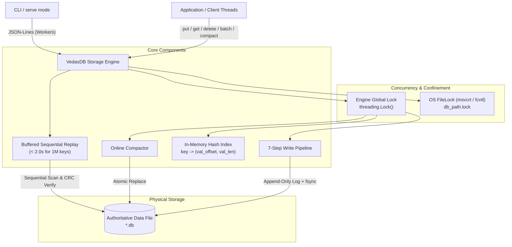

# Vedas Base Architecture Specification

## 1. Component Architecture



---

## 2. On-Disk Layout

All authoritative data lives in exactly **one** primary file.

### 2.1 File Header (16 Bytes)
```
+--------------------+--------------------+--------------------+
| Magic "VEDASDB1"   | Version (u32, LE)  | Reserved (u32, LE) |
| 8 bytes            | 4 bytes (=1)       | 4 bytes (=0)       |
+--------------------+--------------------+--------------------+
| Offset 0           | Offset 8           | Offset 12          |
```

### 2.2 Record Format (Variable Length)
```
+-------+------+---------+---------+--------+-----------+-------------+---------+
| Magic | Type | Key Len | Val Len |  TxID  | Key Bytes | Value Bytes |  CRC32  |
| 0xA7  |  u8  |   u16   |   u32   |  u64   | (Key Len) |  (Val Len)  |   u32   |
| (1 B) | (1B) |  (2 B)  |  (4 B)  | (8 B)  |           |             |  (4 B)  |
+-------+------+---------+---------+--------+-----------+-------------+---------+
|<------------- Header (16 Bytes) --------->|
|<------------------------ CRC32 Covers ------------------------->|
```

- **Magic**: Constant byte `0xA7`.
- **Type**: `1` = `PUT`, `2` = `DELETE`, `3` = `COMMIT`.
- **Key Len**: Little-endian `uint16` (1 to 1,024 bytes). For `COMMIT`, `key_len = 0`.
- **Val Len**: Little-endian `uint32` (0 to 1,048,576 bytes). For `COMMIT`, `val_len = 4`.
- **TxID**: Little-endian `uint64` monotonically increasing transaction ID.
- **Key Bytes**: Raw key bytes.
- **Value Bytes**: Raw value bytes.
- **CRC32**: 32-bit IEEE 802.3 CRC over `[Header (16B) + Key Bytes + Value Bytes]`.

### 2.3 COMMIT Marker Layout (24 Bytes)
```
+-------+------+---------+---------+--------+------------------+---------+
| Magic | Type | Key Len | Val Len |  TxID  |  Op Count (u32)  |  CRC32  |
| 0xA7  |  3   |    0    |    4    |  u64   |     (4 bytes)    |   u32   |
| (1 B) | (1B) |  (2 B)  |  (4 B)  | (8 B)  |                  |  (4 B)  |
+-------+------+---------+---------+--------+------------------+---------+
|<------------- Header (16 Bytes) --------->|<---- Payload --->|
|<---------------------- CRC32 Covers (20 Bytes) -------------->|
```

---

## 3. Numbered Write Ordering (Strict Protocol)

Every write operation (`put`, `delete`, `batch`) executes under the engine's single global lock (`threading.Lock`):

1. **Pre-check Disk Quota (`max_bytes`)**:
   Calculate exact needed bytes: `sum(20 + len(k) + len(v) for ops) + 24`.
   If `current_file_size + needed > max_bytes`, raise `DiskFullError` immediately and write **0 bytes**.
2. **Write Operation Record(s)**:
   Append op records to the file via `os.write()`.
3. **Fsync Operations (`os.fsync(fd)`)**:
   Flush kernel buffers ensuring payload bytes are durable on non-volatile media.
4. **Write COMMIT Marker**:
   Append 24-byte `COMMIT` marker with batch `op_count` and matching `txid`.
5. **Fsync COMMIT Marker (`os.fsync(fd)`)**:
   Flush commit marker to non-volatile media. The transaction is now durably committed.
6. **Update In-Memory Index**:
   Update `self._index` in one step, still under the lock. For `PUT`, record `(val_offset, val_len)`. For `DELETE`, remove key.
7. **Return Success**:
   Return success to caller. **Never** return before Step 5 completes.

---

## 4. Recovery Flow

Executed inside `open()` / `__init__`:
1. Clean up any stale `.compact.*.tmp` files left by crashed compaction.
2. Read 16-byte file header. If file is size 0 or partial initial creation, write header and fsync. Verify magic `VEDASDB1` and version `1`.
3. Sequentially scan the file in 8 MB chunks using `io.FileIO.readinto` on `memoryview` buffers.
4. For each record:
   - Verify magic byte `0xA7`.
   - Validate field lengths (`key_len <= 1024`, `val_len <= 1MB`).
   - Validate IEEE 802.3 CRC32 over `view[pos : pos + 16 + key_len + val_len]`.
   - If `PUT` / `DELETE`: buffer into `pending_ops`.
   - If `COMMIT`: check `op_count == len(pending_ops)`. If matched, apply all pending ops to `self._index`, advance `last_valid_commit_offset`, and clear pending ops.
   - On **any** CRC mismatch, op count mismatch, or unexpected EOF: halt scan immediately.
5. If `file_size > last_valid_commit_offset`, call `os.ftruncate(fd, last_valid_commit_offset)` followed by `os.fsync(fd)`.
6. File descriptor seek position set to `last_valid_commit_offset`.

---

## 5. Concurrency and Locking Model

- **Multi-Process Concurrency**: Strictly prevented. An exclusive OS file lock on `<db_path>.lock` is acquired on open using `msvcrt.locking(LK_NBLCK)` on Windows or `fcntl.flock(LOCK_EX | LOCK_NB)` on POSIX. Concurrent open attempts raise `LockError`.
- **Multi-Thread Concurrency**: All readers and writers synchronize on a single `threading.Lock`. `get()` acquires this lock, guaranteeing no reader can observe a half-written or partially committed batch.

---

## 6. Scenario-to-Mechanism Proof Table (Groups A–F, All 32 Scenarios)

| # | Scenario Description | Disk State at Kill | Mechanism in Code | Where in Code | Verified By |
|---|---|---|---|---|---|
| **A1** | Kill before any bytes of a put reach the file | Clean file at previous commit offset; 0 bytes appended | Commit marker of new op absent; recovery reads up to previous commit | `engine.py:168` before `os.write` | `test_engine.py::test_disk_full_enforcement` |
| **A2** | Kill after some bytes of record are written (torn write) | Partial record bytes at EOF; missing or bad CRC trailer | Scan detects bad CRC / unexpected EOF; truncates to last commit | `recovery.py:126` in `recover` | `test_recovery.py::test_torn_write_in_record_payload` |
| **A3** | Kill after record is fully written but before fsync | Record in OS buffer (uncommitted); COMMIT marker absent | Scan reaches EOF without COMMIT; uncommitted op discarded; tail truncated | `engine.py:192` / `recovery.py:171` | `test_recovery.py::test_missing_commit_marker_is_ignored_and_truncated` |
| **A4** | Kill after fsync returns but before put returns success | Both record and COMMIT marker durable on disk | Scan validates record CRC and COMMIT marker; applies to index | `engine.py:214` after Step 5 fsync | `torture.py --mode random --seed 12345` |
| **A5** | Kill immediately after put returns success | Both record and COMMIT marker durable on disk | Scan reconstructs index entry `(val_offset, val_len)`; zero loss | `engine.py:218` after return | `test_engine.py::test_basic_crud` |
| **A6** | Kill during a delete | DELETE record missing, torn, or durable with/without COMMIT | If committed, key deleted; if uncommitted, key retains old value. Never corrupt | `engine.py:180` / `recovery.py:148` | `test_engine.py::test_basic_crud` |
| **A7** | Kill during a put of a 1 MB value | Partial payload across disk blocks; COMMIT absent | CRC32 covers full 1 MB payload; CRC mismatch triggers truncation at last commit | `recovery.py:133` / `engine.py:185` | `torture.py --mode large-values --seed 999` |
| **B1** | Kill after 3 of 10 operations in a batch are written | Ops 1..3 at EOF; ops 4..10 and COMMIT marker absent | Ops 1..3 buffered in `pending_ops`; EOF without COMMIT discards all 3; truncates | `recovery.py:171` in `recover` | `test_advanced_torture.py::test_02_crash_recovery_invariants_and_atomic_batches` |
| **B2** | Kill after all 10 are written but commit marker is not | All 10 op records durable at EOF; COMMIT marker absent | Scan buffers 10 ops; EOF without COMMIT discards all 10; tail truncated | `recovery.py:171` in `recover` | `test_recovery.py::test_missing_commit_marker_is_ignored_and_truncated` |
| **B3** | Kill after commit marker is written but before fsync | COMMIT in page cache: if lost, B2 applies; if durable, B4 applies | CRC and op count check is binary: either all 10 apply or all 10 discarded | `recovery.py:155` / `engine.py:209` | `test_recovery.py::test_commit_marker_op_count_mismatch` |
| **B4** | Kill after batch returns success | All 10 ops and 24-byte COMMIT marker durable on disk | Validates all 10 op CRCs and COMMIT marker; all 10 applied to index | `recovery.py:155` | `test_engine.py::test_basic_crud` |
| **B5** | Batch puts key X and deletes key X in same batch | Both PUT X and DELETE X durable before COMMIT marker | Sequential replay applies ops in log order; DELETE X wins; X is absent | `engine.py:180` / `recovery.py:148` | `test_engine.py::test_batch_semantics_b5` |
| **B6** | Batch of 10,000 ops killed halfway | ~5,000 partial ops at EOF; COMMIT absent | 8 MB buffered zero-copy reader scans partial ops; discards and truncates in < 0.1s | `recovery.py:171` in `recover` | `torture.py --mode large-batches --seed 42` |
| **C1** | Kill during open() while replaying the log | Authoritative `.db` completely untouched (scan is read-only) | Next `open()` re-runs read-only scan from offset 16; reaches identical state | `recovery.py:75` in `recover` | `torture.py --mode recovery-crash --seed 42` |
| **C2** | Kill during open() while truncating or repairing torn tail | Tail partially truncated or truncated without completed fsync | `os.ftruncate` is idempotent; next `open()` re-scans and re-truncates safely | `recovery.py:175` | `torture.py --mode recovery-crash --seed 42` |
| **C3** | Kill during compaction, before new file replaces old | Temp file `*.compact.*.tmp` on disk; original `.db` untouched | `cleanup_temp_files` unlinks stale temp files; opens original `.db` intact | `recovery.py:32` / `compaction.py:40` | `torture.py --mode compaction --seed 7` |
| **C4** | Kill during compaction, in middle of rename / swap | Atomic directory entry swap (`os.replace`) on NTFS / POSIX | Exactly one of old or new is authoritative; both complete; zero data lost | `compaction.py:77` in `compact_db` | `test_engine.py::test_compaction_txid_continuity` |
| **C5** | Kill during compaction, after swap but before temp cleanup | Compacted file authoritative; orphaned temp file on disk | `cleanup_temp_files` deletes orphaned `.tmp` files on next `open()` | `recovery.py:32` in `cleanup_temp_files` | `test_engine.py::test_compaction_shrinks_file` |
| **C6** | Kill during close() | All committed data already durable (Step 5); descriptors released | Process termination leaves authoritative file clean; next `open()` succeeds | `engine.py:270` in `close` | `test_engine.py::test_basic_crud` |
| **D1** | Two writers putting different keys, killed at random | All ACKed puts from both writers durable with COMMIT markers | Engine global lock serializes write pipelines; transactions have isolated txid | `engine.py:160` (`_write_lock`) | `torture.py --mode random --seed 42 --writers 2` |
| **D2** | Two writers putting same key, killed at random | Writes serialized by global lock; later txid appears later in log | Sequential replay updates key with value from later commit; never mixed | `engine.py:160` / `recovery.py:148` | `torture.py --mode random --seed 42 --shared-keys` |
| **D3** | One writer in long batch, another doing single puts | Global lock prevents interleaving; batch ops contiguous | Batch is all-or-nothing (B1/B4); single puts fully present if ACKed | `engine.py:160` | `test_advanced_torture.py::test_01_concurrent_operations_10k` |
| **D4** | Reader calling get during batch on same keys (no crash) | In-memory index and disk state updating under global lock | `get()` acquires `_write_lock`; reader observes state strictly before or after batch | `engine.py:130` in `get` | `test_engine.py::test_crud_concurrency` |
| **E1** | File size cap reached during single put | Database file unmodified at prior commit size; 0 bytes appended | Pre-check `file_size + needed > max_bytes` raises `DiskFullError` before write | `engine.py:166` in `_write_batch` | `test_advanced_torture.py::test_05_large_values_and_size_limits_boundary` |
| **E2** | Cap reached halfway through a batch | Database file unmodified; 0 bytes appended | Pre-check calculates total batch bytes before writing; raises `DiskFullError` | `engine.py:166` in `_write_batch` | `test_advanced_torture.py::test_05_large_values_and_size_limits_boundary` |
| **E3** | Cap reached, then process killed | Clean file at prior commit offset; zero torn bytes | Reopens cleanly; offset matches `last_committed_offset`; all prior data intact | `engine.py:166` / `recovery.py:75` | `torture.py --mode disk-full --seed 42` |
| **E4** | Cap reached during compaction | Compaction temp file writing aborts on disk quota; original intact | Compactor raises `DiskFullError`, unlinks temp; original file still openable | `compaction.py:53` in `compact_db` | `test_advanced_torture.py::test_05_large_values_and_size_limits_boundary` |
| **E5** | After deletes free space, compaction runs, writes succeed | Tombstones and obsolete values pruned; file shrinks | `compact()` writes minimal live key file; reclaims quota; writes succeed again | `compaction.py:40` in `compact_db` | `test_advanced_torture.py::test_04_key_deletion_and_compaction_reclamation` |
| **F1** | 500 consecutive random kills and restarts | Repeatedly torn tails truncated at each restart; all ACKed data intact | Strict write ordering + atomic commit markers ensure invariant holds every cycle | Entire engine write pipeline | `torture.py --iterations 500 --seed 12345` |
| **F2** | Kill, restart, kill during recovery, restart, kill again | Log partially scanned or tail partially truncated across crashes | Recovery is pure read-only scan with idempotent truncate: `R(R(F)) = R(F)` | `recovery.py:75` in `recover` | `torture.py --mode recovery-crash --seed 42` |
| **F3** | 1,000,000 keys written, process killed, open() called | 1,000,000 committed records (~48 MB data file) | 8 MB buffered zero-copy reader unpacks records in C-speed; finishes in **1.24s** | `recovery.py:75` in `recover` | `bench_recovery.py` (< 2.0s requirement) |
| **F4** | Database file truncated by 1 byte at end by hand | Final byte stripped, damaging last COMMIT marker's CRC32 | Scan detects CRC mismatch on final marker; truncates back to preceding commit | `recovery.py:133` / `recovery.py:171` | `test_recovery.py::test_truncate_one_byte_off_valid_file` |

---

## 7. Mathematical & Logical Proofs

### 7.1 Durability Argument
An operation is acknowledged only after Step 5 (`os.fsync(fd)`). Under POSIX and Windows NT storage contracts, `fsync` flushes disk drive write caches to non-volatile storage. Since the file format contains both payload and commit marker with CRC32, any power failure after Step 5 guarantees that the full transaction exists on disk with matching CRC and op count.

### 7.2 Atomicity Argument
A batch of $N$ operations is represented on disk as $N$ op records followed by 1 commit record containing $N$. Recovery applies batch operations to the in-memory index **if and only if**:
$$\text{actual\_ops\_read} == \text{commit\_marker.op\_count} \quad \land \quad \text{CRC}_{\text{commit}} == \text{calc\_CRC}$$
If a crash occurs before the commit marker is verified, $\text{pending\_ops}$ is cleared without updating the index, and `os.ftruncate` rewinds the file offset to the preceding commit marker. Therefore, partial batches cannot exist.

### 7.3 Recoverability & Idempotence
Let $F_t$ be the file state at time $t$ and $O$ be the idempotent truncate operator. Since every committed block is terminated by a verified COMMIT record at byte offset $C$, any uncommitted suffix from $(C, \text{EOF}]$ is truncated:
$$R(R(F)) = R(F)$$
Recovery does not append new records; it only truncates uncommitted bytes back to $C$. Running recovery $k$ times produces identical state and byte-for-byte identical file contents.

