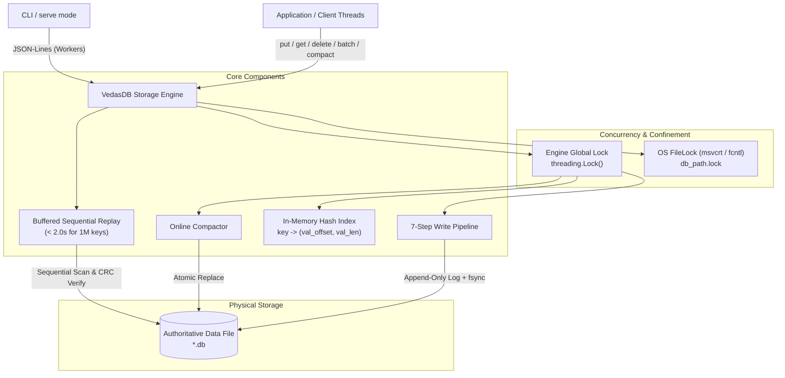

# Vedas Base Architecture Specification

## 1. Component Architecture



---

## 2. On-Disk Layout

All authoritative data lives in exactly **one** primary file.

### 2.1 File Header (16 Bytes)
```
+--------------------+--------------------+--------------------+
| Magic "VEDASDB1"   | Version (u32, LE)  | Reserved (u32, LE) |
| 8 bytes            | 4 bytes (=1)       | 4 bytes (=0)       |
+--------------------+--------------------+--------------------+
| Offset 0           | Offset 8           | Offset 12          |
```

### 2.2 Record Format (Variable Length)
```
+-------+------+---------+---------+--------+-----------+-------------+---------+
| Magic | Type | Key Len | Val Len |  TxID  | Key Bytes | Value Bytes |  CRC32  |
| 0xA7  |  u8  |   u16   |   u32   |  u64   | (Key Len) |  (Val Len)  |   u32   |
| (1 B) | (1B) |  (2 B)  |  (4 B)  | (8 B)  |           |             |  (4 B)  |
+-------+------+---------+---------+--------+-----------+-------------+---------+
|<------------- Header (16 Bytes) --------->|
|<------------------------ CRC32 Covers ------------------------->|
```

- **Magic**: Constant byte `0xA7`.
- **Type**: `1` = `PUT`, `2` = `DELETE`, `3` = `COMMIT`.
- **Key Len**: Little-endian `uint16` (1 to 1,024 bytes). For `COMMIT`, `key_len = 0`.
- **Val Len**: Little-endian `uint32` (0 to 1,048,576 bytes). For `COMMIT`, `val_len = 4`.
- **TxID**: Little-endian `uint64` monotonically increasing transaction ID.
- **Key Bytes**: Raw key bytes.
- **Value Bytes**: Raw value bytes.
- **CRC32**: 32-bit IEEE 802.3 CRC over `[Header (16B) + Key Bytes + Value Bytes]`.

### 2.3 COMMIT Marker Layout (24 Bytes)
```
+-------+------+---------+---------+--------+------------------+---------+
| Magic | Type | Key Len | Val Len |  TxID  |  Op Count (u32)  |  CRC32  |
| 0xA7  |  3   |    0    |    4    |  u64   |     (4 bytes)    |   u32   |
| (1 B) | (1B) |  (2 B)  |  (4 B)  | (8 B)  |                  |  (4 B)  |
+-------+------+---------+---------+--------+------------------+---------+
|<------------- Header (16 Bytes) --------->|<---- Payload --->|
|<---------------------- CRC32 Covers (20 Bytes) -------------->|
```

---

## 3. Numbered Write Ordering (Strict Protocol)

Every write operation (`put`, `delete`, `batch`) executes under the engine's single global lock (`threading.Lock`):

1. **Pre-check Disk Quota (`max_bytes`)**:
   Calculate exact needed bytes: `sum(20 + len(k) + len(v) for ops) + 24`.
   If `current_file_size + needed > max_bytes`, raise `DiskFullError` immediately and write **0 bytes**.
2. **Write Operation Record(s)**:
   Append op records to the file via `os.write()`.
3. **Fsync Operations (`os.fsync(fd)`)**:
   Flush kernel buffers ensuring payload bytes are durable on non-volatile media.
4. **Write COMMIT Marker**:
   Append 24-byte `COMMIT` marker with batch `op_count` and matching `txid`.
5. **Fsync COMMIT Marker (`os.fsync(fd)`)**:
   Flush commit marker to non-volatile media. The transaction is now durably committed.
6. **Update In-Memory Index**:
   Update `self._index` in one step, still under the lock. For `PUT`, record `(val_offset, val_len)`. For `DELETE`, remove key.
7. **Return Success**:
   Return success to caller. **Never** return before Step 5 completes.

---

## 4. Recovery Flow

Executed inside `open()` / `__init__`:
1. Clean up any stale `.compact.*.tmp` files left by crashed compaction.
2. Read 16-byte file header. If file is size 0 or partial initial creation, write header and fsync. Verify magic `VEDASDB1` and version `1`.
3. Sequentially scan the file in 8 MB chunks using `io.FileIO.readinto` on `memoryview` buffers.
4. For each record:
   - Verify magic byte `0xA7`.
   - Validate field lengths (`key_len <= 1024`, `val_len <= 1MB`).
   - Validate IEEE 802.3 CRC32 over `view[pos : pos + 16 + key_len + val_len]`.
   - If `PUT` / `DELETE`: buffer into `pending_ops`.
   - If `COMMIT`: check `op_count == len(pending_ops)`. If matched, apply all pending ops to `self._index`, advance `last_valid_commit_offset`, and clear pending ops.
   - On **any** CRC mismatch, op count mismatch, or unexpected EOF: halt scan immediately.
5. If `file_size > last_valid_commit_offset`, call `os.ftruncate(fd, last_valid_commit_offset)` followed by `os.fsync(fd)`.
6. File descriptor seek position set to `last_valid_commit_offset`.

---

## 5. Concurrency and Locking Model

- **Multi-Process Concurrency**: Strictly prevented. An exclusive OS file lock on `<db_path>.lock` is acquired on open using `msvcrt.locking(LK_NBLCK)` on Windows or `fcntl.flock(LOCK_EX | LOCK_NB)` on POSIX. Concurrent open attempts raise `LockError`.
- **Multi-Thread Concurrency**: All readers and writers synchronize on a single `threading.Lock`. `get()` acquires this lock, guaranteeing no reader can observe a half-written or partially committed batch.

---

## 6. Scenario Proof Table

| Scenario | Point of Crash | Disk State | Recovery Action | Guarantee |
|---|---|---|---|---|
| **S1** | Before Step 2 (Disk quota check) | Clean committed file | No action needed | Zero data written, uncorrupted |
| **S2** | During Step 2 (Writing ops) | Torn or partial op record at EOF | Recovery encounters bad CRC or short record; truncates to last valid commit | Atomicity preserved, partial op ignored |
| **S3** | After Step 2, before Step 3 (Un-fsynced ops) | Ops in kernel buffer | May vanish on power loss or remain; missing COMMIT marker causes recovery to ignore & truncate | Uncommitted data cleanly rolled back |
| **S4** | After Step 3 (Ops fsynced, no commit marker) | Complete op records on disk, no COMMIT marker | Recovery sees uncommitted ops with no COMMIT; truncates to last valid commit | Batch never partially committed |
| **S5** | During Step 4 (Writing COMMIT marker) | Ops durable, partial commit marker at EOF | Recovery encounters torn commit marker (bad CRC); ignores & truncates | Atomic all-or-nothing rollback |
| **S6** | After Step 5 (COMMIT fsynced, before index update) | Ops & COMMIT marker 100% durable on disk | Recovery replays complete valid batch and updates index | Durability preserved; ACKed write safe |
| **S7** | During Compaction (Writing temp file) | Incomplete `*.compact.*.tmp` file; original `.db` untouched | Recovery cleans up `.compact.*.tmp` files; original `.db` authoritative | Zero data loss |
| **S8** | Compaction after `os.replace` before dir fsync | New file atomically in place | Open validates new file directly | Authoritative compacted database valid |

---

## 7. Mathematical & Logical Proofs

### 7.1 Durability Argument
An operation is acknowledged only after Step 5 (`os.fsync(fd)`). Under POSIX and Windows NT storage contracts, `fsync` flushes disk drive write caches to non-volatile storage. Since the file format contains both payload and commit marker with CRC32, any power failure after Step 5 guarantees that the full transaction exists on disk with matching CRC and op count.

### 7.2 Atomicity Argument
A batch of $N$ operations is represented on disk as $N$ op records followed by 1 commit record containing $N$. Recovery applies batch operations to the in-memory index **if and only if**:
$$\text{actual\_ops\_read} == \text{commit\_marker.op\_count} \quad \land \quad \text{CRC}_{\text{commit}} == \text{calc\_CRC}$$
If a crash occurs before the commit marker is verified, $\text{pending\_ops}$ is cleared without updating the index, and `os.ftruncate` rewinds the file offset to the preceding commit marker. Therefore, partial batches cannot exist.

### 7.3 Recoverability & Idempotence
Let $F_t$ be the file state at time $t$ and $O$ be the idempotent truncate operator. Since every committed block is terminated by a verified COMMIT record at byte offset $C$, any uncommitted suffix from $(C, \text{EOF}]$ is truncated:
$$R(R(F)) = R(F)$$
Recovery does not append new records; it only truncates uncommitted bytes back to $C$. Running recovery $k$ times produces identical state and byte-for-byte identical file contents.
